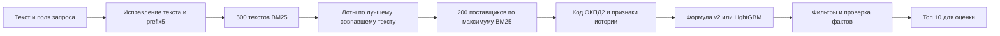

# Как поднять качество подбора алгоритмами

Ревью от 2 октября 2026, задача #522. Исходная ревизия `75bd77e`, затем сверка с обновлениями `main`. Цель — повысить качество рекомендаций и скорость без новых LLM и обучения. Изучены `src/match`, протокол eval и сохранённые результаты; holdout не открывался. Это внутренний аудит с независимыми проходами по поиску, метрикам и производительности.

Главная проблема — команда меняет ранжировщики раньше, чем точно локализует потери, и смешивает разные пользовательские режимы. Сначала нужно исправить режим запроса без заказчика, измерять потери на каждой стадии и улучшать извлечение предмета и объединение кандидатов. Очередное обучение не является обязательным шагом ни для одной из этих задач.

При этом утверждение «обучение вообще не приносит пользы» неверно по данным репозитория: `L-long` улучшил recall@10 с 0.5721 до 0.5906, парная Δ +0.0185, 95% CI [+0.012, +0.026]; на свежих 2 000 — с 0.5627 до 0.5749. Это уже полученная польза существующей модели, а не предложение продолжать обучение. **Отключать её во всех режимах без сравнения тоже нельзя.**

## Что сейчас происходит с запросом



Кандидатов отбирают до учёта ОКПД2. Дополнительные источники `candidates.customer` и `candidates.okpd2` в исходном продуктовом конфиге выключены. Лестница поиска по коду запускается только при **нуле** текстовых кандидатов. Один слабый текстовый результат уже закрывает этот путь. См. [`search.py`](../../src/match/search.py), [`store.py`](../../src/match/store.py), [`fallback.py`](../../src/match/fallback.py).

## Выводы по приоритету

### Сначала согласовать алгоритм с реальным входом

**Подтверждено, P0.** На 384 одинаковых запросах только по названию, без заказчика, бюджета, кода и канала:

| Метод | recall@10 | winner@10 |
|---|---:|---:|
| Текущий R-long | 0.3565 | 0.3828 |
| Формула v2 без ML | 0.4103 | 0.4375 |
| Разница v2 минус R-long | +0.0538 | +0.0547 |

Парный 95% CI разницы winner@10: [+0.0182, +0.0885]. В ЭМ прирост +0.0918; в АИС ГЗ +0.0113 с интервалом, включающим ноль. Winner@1 на всём наборе не вырос: Δ −0.0026 [−0.0313, +0.0260]. Значит, это улучшение попадания в десятку, а не доказанное улучшение первого места.

Источники: [`X-art-B-name-prod-rlong.json`](../../eval/results/X-art-B-name-prod-rlong.json), [`X-art-B-name-v2.json`](../../eval/results/X-art-B-name-v2.json). Снимок данных одинаковый, коммиты различаются и записаны в файлах; это сравнение сохранённых прогонов, не новый прогон текущего HEAD. Важная оговорка: у v2 `spell=false`, у R-long `spell=true`. Здесь сравниваются полные конфигурации, а не изолированное отключение ранжировщика. Перед включением правила нужен контроль v2 со `spell=true`.

Обновление из `main` во время аудита: опубликованы `TO-*` на 2 000 title-only кейсах, один commit `4c90525` и один снимок. `TO-rlong`: recall@10 0.4132, winner@10 0.4408; `TO-v2`: 0.4782 и 0.4965. Winner@1 у v2 ниже: 0.1876 против 0.2068. Здесь тоже отличается `spell`, поэтому рост нельзя целиком приписывать отказу от LightGBM. Нужна явная договорённость, важнее ли попадание в десятку, чем первое место; протокол не должен скрывать этот компромисс. Источники: `eval/results/TO-rlong.json`, `TO-v2.json`.

**Действие:** довести #490 — без заказчика применять v2; #511 — отдельно улучшать этот путь. Эти задачи уже заняты, их реализация в #522 не дублируется. Проверять name-only отдельно от полного лота. `scripts/fresh_eval.py --free-text` сохраняет заказчика, бюджет и канал; его цифры нельзя выдавать за качество запроса с одной строкой текста.

### Сравнивать одинаковый вход во всех точках продукта

**Подтверждено по коду, P0 для достоверности цифр.** `src/ingest/notice.py::notice_query()` обычно отдаёт `/api/lot` только заголовок: позиции нужны лишь вместо шаблонного предмета. `src/eval/build_cases.py::query_text()` добавляет названия позиций к заголовку всегда, до `MAX_ITEMS`. Поэтому штатный dev даёт алгоритму более подробный текст, чем открытие того же лота через API. Это разница входа, даже при общем `pipeline.pick()`.

Кроме того, `src/ingest/predict.py::predict_full()` вызывает `search()` напрямую в двух ветках и не применяет исправление текста из `pipeline._spelled()`. В режиме full есть собственная логика проверки и смешивания кода с текстом; механически заменить её на `pipeline.pick()` нельзя.

**Действие:** один детерминированный способ сборки текста из заголовка и позиций для API, CSV и eval; отдельно оставить намеренно бедный title-only режим. Проверять совпадение Query и ranked на одном лоте в API, загрузке CSV и backtest с одинаковым `as_of` и доступными полями. До этого не обещать, что 0.591 dev является качеством обычного ввода заголовка. Это отдельное изменение поведения, в #522 не включено.

### Исправить неверный диагноз потерь

**Подтверждено, P0.** В `research/ERROR_ANALYSIS.md` отсутствие победителя в топ-20 было ошибочно объявлено потолком пула кандидатов. Пул содержит до 200 поставщиков: позиции 21–200 — потери ранжирования, а не извлечения.

Сохранённый [`E6-base.json`](../../eval/results/E6-base.json), commit `5a8e662`, позволяет разделить 1 978 кейсов с победителем:

| Где победитель | Кейсов | Доля всех кейсов с победителем |
|---|---:|---:|
| В топ-10 | 1 181 | 59.71% |
| В кандидатах, но ниже топ-10 | 333 | 16.84% |
| Вне кандидатов | 464 | 23.46% |

Из 797 промахов топ-10 **58.2% приходятся на извлечение, 41.8% — на ранжирование**. В частности, 194 победителя находятся в кандидатах ниже топ-20. Это исторический срез R-198, не новый потолок R-long; в `E6-base` нет современного поля `data`, поэтому уровень с другим снимком напрямую не переносится.

**Действие:** во всех новых алгоритмических экспериментах сохранять `candidate_winner_hit`, количество и состав кандидатов до ранжирования, затем победителя после top-10 и фильтров. Дополнительно отделять победителей, вообще отсутствующих в доступной истории. Тогда видно, что именно нужно чинить, и нельзя выдать рост candidate recall за рост конечного score. Неверная строка разбора ошибок исправлена в #522.

### Пул должен объединять разные сигналы и реально соблюдать квоты

**Подтверждённый дефект, P1.** `candidates.extra()` запрашивал `LIMIT N`, затем выкидывал уже найденных. При квоте 30 и 30 дублях источник добавлял ноль, даже если следующий поставщик был новым. Второй источник также терял квоту на пересечении с первым. Из-за этого эксперимент проверял не заявленные «N дополнительных кандидатов».

**Исправление #522:** запрашивать не более `N + len(seen)` поставщиков и брать первые N новых; перед вторым источником учитывать кандидатов первого. Store возвращает уникальные ИНН через группировку, поэтому такого запаса достаточно. Нулевые квоты не делают SQL-запросов. Порядок источника и исключение собственного лота сохраняются. Дефолтные квоты остаются нулевыми; роста продуктового recall от этого исправления пока не заявляем.

**Следующий эксперимент, гипотеза:** union независимых списков с квотами — текст, точный/близкий код, похожие закупки заказчика. Не просто «200 → 1000»: иначе популярные универсальные поставщики занимают дополнительные места. После объединения считать сравнимое текстовое соответствие для всех источников, а не автоматически оставлять новым кандидатам BM25=0. Вначале — детерминированное объединение рангов или формула, существующая модель — отдельный контроль.

Почему это не обещание лёгких +10 п.п.: `E6-cust-ranker` расширил число доступных победителей с 1 514 до 1 562 (+48), но старая модель (`E6-cust-untrained`) добавила лишь 6 попаданий в топ-10, новая — 22. Прирост с новой моделью на свежем наборе статистически не подтверждён. У новых для заказчика победителей candidate hit вообще не вырос: 559/889 в обоих пулах. Простое добавление знакомых поставщиков уже пробовали; оно не решает поиск новых.

### Поиск должен учитывать предмет закупки и несколько позиций

**Подтверждено по коду, прирост пока гипотеза, P1.** Сейчас лот наследует лучший документ, поставщик — максимальный BM25 своего лота. Дальше учитывается число похожих лотов, но не покрытие отдельных предметов запроса. Поставщик одной позиции может выглядеть подходящим для всей корзины. `prefix5` также не различает часть слов с общим началом; замена морфологии целиком уже требует своего сравнения.

**Эксперимент A:** выделить служебную оболочку запроса («оказание услуг», «для нужд», год, заказчик) и предмет; выполнить поиск по исходному тексту и предмету отдельными каналами. Сохранять артикулы, марки, размеры и числа; не удалять их общим стоп-листом. Для запроса без кода добавить совпадение типа «товар / работа / услуга», чтобы обслуживание оборудования не превращалось в поставку самого оборудования. Не считать первые три слова хорошим приближением предмета.

**Эксперимент B:** несколько позиций → отдельный поиск каждой → объединение поставщиков → покрытие позиций. Первый простой вариант ранжирования: взвешенная доля покрытых позиций плюс среднее ограниченное соответствие по каждой, с весом редкости позиции и отдельным учётом обязательных артикулов. Сравнить с max-BM25 и с равными весами; не награждать дубли одной позиции. Это алгоритмическая гипотеза, параметры до замера не считаются доказанными.

Есть и конкретный риск исправления текста: `Speller({'аппз': 1000}).correct('аппв3x2')` меняет артикул на `аппз3x2`, хотя модуль обещает не трогать коды. Отдельный следующий fix — защищать буквенно-цифровые токены целиком; проверить реальные артикулы и раскладку, поскольку одно blanket-правило может ухудшить исправление обычных опечаток. В #522 этот путь не менялся.

### Повторы закупок искать по похожести лота

**Гипотеза, P1.** Сигнал «работал с заказчиком» слишком общий: поставщик бумаги может оказаться сильным кандидатом на ремонт. Нужна история **похожей закупки** этого заказчика: нормализованный предмет, код, близкий масштаб НМЦК, дата. Начать с точного/почти точного повтора, затем ограниченного kNN по BM25 прошлых лотов. Агрегировать поддержку поставщика от нескольких разных лотов с затуханием давности и потолком вклада одного лота.

Считать канал ЭМ отдельно от АИС ГЗ: в последнем в данных часто только исполнитель, поэтому высокий win rate не доказывает конкурентоспособность. Все связи должны быть строго до `as_of`, собственный лот исключается. Новое обучение для такого scorer не требуется. Сравнить точный повтор, kNN и простой incumbent отдельно: иначе нельзя понять источник прироста.

### Обновление истории полезнее слепого добавления эмбеддингов

**Подтверждено в сохранённых экспериментах, P1.** Для 671 сентябрьского кейса доступная история до сентября вместо июля подняла recall@10 с 0.5675 до 0.5893, Δ +0.0218 [+0.005, +0.038]. Winner@10 вырос с 0.6036 до 0.6185, но CI разницы [−0.003, +0.034] включает ноль. Это довод за свежие индексы и агрегаты, а не доказательство роста всех метрик.

Источники: [`X-fresh-sep-0701.json`](../../eval/results/X-fresh-sep-0701.json), [`X-fresh-sep-0901.json`](../../eval/results/X-fresh-sep-0901.json). Для backtest обновлять историю только данными до даты запроса; нельзя «освежить» её будущими победителями.

Напротив, `E485-short-rrf-w3` на 2 000 запросах из первых трёх слов ухудшает recall@10 с 0.3578 до 0.3413, Δ −0.0165 [−0.027, −0.006]. Winner@10: 0.3665 → 0.3493. Обычный полный запрос: 0.5721 → 0.5710. **Повторять этот гибрид без новой, локализованной причины ошибки не стоит.** Эти прогоны используют R-198; это не абляция текущего R-long. Три первых слова также не равны естественному короткому запросу человека.

### Ускорять конкретные стадии и сохранять точную выдачу

**Подтверждено по реализации, P1 для вычислительных затрат.** В `LotIndex.lot_hits()` исходный порядок конкатенации уже кодирует ранг документа. Старый код всё равно разворачивал score, doc и rank для каждой связи «документ → лот», делал `lexsort`, затем `unique`.

**Исправление #522:** первый индекс каждого уникального лота получается одним `unique(return_index=True)`; исходный документ восстанавливается по накопленным длинам через `searchsorted`. Так сохраняются порядок лотов, точные score и выбор первого документа при равенстве. Удаляются три промежуточных массива по числу связей и одна сортировка. Замер и границы его применимости приведены ниже.

Другой кандидат на оптимизацию — SHAP: `pipeline.pick()` запрашивает 200 результатов, а `ranker.rerank()` вычисляет вклады и текст объяснения для всех. Для интерфейса можно вычислять их только для видимой страницы и её соседей после фильтров; для численных eval они не нужны. Но это отдельная правка с проверкой карточки и объяснения соседей, а не простое отключение объяснимости. Сначала профиль времени; ускорение здесь пока не измерено.

## Порядок следующей работы

| Очередь | Изменение | Что должно улучшиться | Условие принятия |
|---|---|---|---|
| 1 | Закончить #490 и #511 | Реальный запрос без заказчика | Полный name-only dev и свежая выборка, отдельно winner@1/10 |
| 2 | Диагностика всех стадий и исправленные квоты | Понятно, где теряется победитель | Candidate hit и итоговые метрики на одинаковых query_id |
| 3 | Предмет, артикулы, несколько позиций | Неоднозначные и длинные запросы | Срезы товаров/услуг и single/multi-item, без общего ухудшения |
| 4 | Union источников и похожие повторы | Победители вне текстового пула | Рост candidate hit конвертируется в top-10; новые не проседают |
| 5 | Актуальная история и отложенные объяснения | Свежесть и p95 | Нет временной утечки; паритет выдачи для оптимизаций |

Отбирать 1–3 заранее заданных варианта на фиксированном dev-сэмпле, затем проверять лучший на всех 2 000 и на свежем наборе того же периода. Правило принятия репозитория: recall@10 ≥ +0.01, нижняя граница парного 95% CI > 0, winner@10 не хуже чем −0.01. Для name-only обязательно отдельно фиксировать winner@1 и winner@10. Свежий dev не называть независимым holdout. Не запускать много вариантов до случайно зелёного результата.

Производительность оценивать по стадиям и p50/p95 в одном процессе на том же снимке; размер пула, память и количество SQL — рядом с качеством. Исправление квот требует нового eval при их включении. Оптимизация с точным паритетом может публиковаться отдельно от изменения ранжирования.

## Как перепроверить выводы без обучения

```bash
uv run --frozen python -m src.eval.compare X-art-B-name-v2 X-art-B-name-prod-rlong
uv run --frozen python -m src.eval.compare L-long L-base
uv run --frozen python -m src.eval.compare LF-long LF-base
uv run --frozen python -m src.eval.compare E485-short-rrf-w3 E485-base-w3
uv run --frozen python -m src.eval.compare X-fresh-sep-0901 X-fresh-sep-0701
```

Все команды выше читают уже сохранённые результаты. Они не обучают модели и не перезапускают подбор. Числа относятся к указанным артефактам, а не к новому качеству после #522.

## Исправления и проверка в задаче 522

Кроме квот и `lot_hits`, исправлен `src/eval/compare.py::require_same_cases()`: раньше повтор query_id во втором прогоне молча схлопывался в словарь, и сравнение могло показать некорректный положительный результат. Теперь дубли отклоняются симметрично; пустые прогоны не считаются сопоставимыми. Это защита принятия изменений по метрикам, а не улучшение самого поиска.

Замер `lot_hits` на готовом индексе cutoff 2025-07-01: 1 047 638 документов, 2 086 901 связь с лотами; 24 равномерно выбранных dev-запроса, по 500 hits, 25 повторов каждого метода в чередующемся порядке. Точные массивы `lot_id`, `score`, `doc_id` и их dtype совпадают для всех запросов. Медиана времени этапа: **1.004 → 0.172 мс**, медиана парного ускорения **5.85×**. Медиана пиковых отслеживаемых аллокаций: **206 308 → 106 910 байт**, около −48.2%. Загрузка индекса, BM25, SQL, ранжирование и RSS процесса в эти числа не входят. Экономия около 0.83 мс на запрос сама по себе не решает latency продукта.

Артефакт с хешами кода, индекса, кейсов и покейсными замерами: [A522-lot-hits.json](../../eval/results/A522-lot-hits.json). Повтор из корня репозитория:

```bash
uv run --frozen python -m scripts.bench_lot_hits --index indexes/bm25-0591312044e44272
uv run --frozen pytest tests/unit/test_candidates.py tests/unit/test_lot_hits.py tests/unit/test_compare.py
make check-changed
```

Индекс с этим ключом — локальный снимок и не хранится в git; можно указать другой готовый cutoff-индекс с совместимым токенизатором, но тогда это новый замер. Тесты `lot_hits` дополнительно проверяют 100 случайных вариантов пересечения документов, пустые документы, равные score, повторные hits и большие идентификаторы. Регрессия квот воспроизведена на настоящем `ParquetStore` с синтетическими данными до исправления. Для продуктовой конфигурации дополнительные источники выключены; доказанного роста recall от #522 нет. Полный паритет конечных ranked на 2 000 кейсах этим микрозамером не подменяется.

Проверка интеграции на `2a0d6f0c` (включает `origin/main` `6525a0e`): `make check-changed` — **OK**; Ruff и Pyright без ошибок; **1 933 pytest passed, 36 skipped**; **36 Playwright passed**; проверки слоёв, настроек, holdout и заглушек прошли. Пропущенные проверки не считаются выполненными. Независимый reviewer: merge. Обучение и переобучение моделей в рамках #522 не запускались. Последующее изменение документа добавляет только эту запись проверки.
