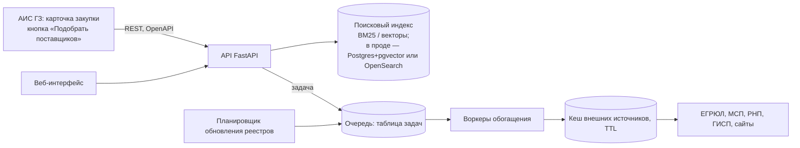

# Масштабирование и встраивание в АИС ГЗ

Источник: раздел 11 `docs/source/hackathon-research-workflow.md`. Пункт 8 условий. Показываем три
вещи: схему, что из неё реально работает, цифры.

## 1. Схема

Встраивание: REST API по спецификации `docs/openapi.json` (генерируется из `src/contracts.py`,
`make openapi`) или кнопка «Подобрать поставщиков» в карточке закупки; выгрузка в Excel.

## 2. Что реально работает

- `make up` — docker-compose: `api` (FastAPI + UI), `worker` (обогащение), `db` (Postgres с
  таблицей задач). Обогащение идёт через очередь, а не синхронно в запросе (`POST /api/enrich/{inn}` → 202).
- `make demo` — то же локально без Docker (SQLite-очередь), D-007.
- Кеш источников с TTL — `src/sources/cache.py`; демо работает без интернета.
- Compose — вне критического пути демо (D-017 г), реально поднимается в T-13 (`make up`, замер ИНН/мин); условия сдачи — `[СПРОСИТЬ Q-12]`.

## 3. Цифры — `[ОБНОВИТЬ]`, только замером командой

| Что | Число | Команда замера | Файл |
|---|---|---|---|
| Latency поиска (p50/p95) | `[ОБНОВИТЬ]` | | |
| Время обогащения одного контрагента | `[ОБНОВИТЬ]` | | |
| Время и стоимость обогащения всей базы (оценка = замер × объём) | `[ОБНОВИТЬ]` | | |
| Прогрев top-200 активных поставщиков через очередь, пауза 1 с. Путь: pb отвечал по первым 5 ИНН, на шестом капча (HTTP 400), дальше pb не запрашивался (пауза 15 мин, D-052), 195 ИНН прошли через реестр МСП, у 30 из них добавлен ГИР БО | 200 из 200 за 581 с = **20,7 ИНН/мин** (скорость пути реестр МСП / ГИР БО), 0 ошибок; название у 187 из 200. Повторный запуск: 0 из 200 к обработке (`cache/prefetch-run2.log`). Оценка: 10 000 ИНН ≈ 8 ч одним воркером на том же пути и паузах | `uv run python -m src.worker.prefetch --top 200` (DATA_PROCESSED_DIR, SOURCE_CACHE, DATABASE_URL — общие файлы `cache/`); названия: `enrich(inn).name` по кешу при `ENRICH_OFFLINE=1`, без «ИНН …» в названии | `cache/prefetch-run1.log`, `cache/prefetch-run2.log` (вне git) |

Числа переносятся в `pitch/facts.md`.

## Дальше не идём

Kubernetes, микросервисы, авторизация за два дня — потерянное время.
