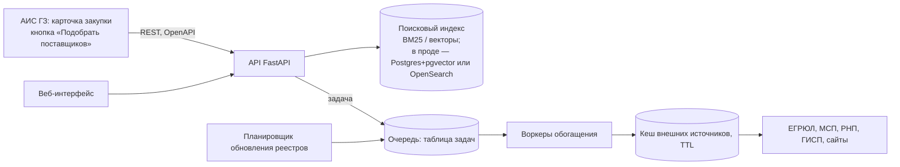

# Масштабирование и встраивание в АИС ГЗ

Источник: раздел 11 `docs/source/hackathon-research-workflow.md`. Пункт 8 условий. Показываем три
вещи: схему, что из неё реально работает, цифры.

## 1. Схема

Встраивание: REST API по спецификации `docs/openapi.json` (генерируется из `src/contracts.py`,
`make openapi`) или кнопка «Подобрать поставщиков» в карточке закупки; выгрузка в Excel.

## 2. Что реально работает

- `make up` — docker-compose: `api` (FastAPI + UI), `worker` (обогащение), `db` (Postgres с
  таблицей задач). Обогащение идёт через очередь, а не синхронно в запросе (`POST /api/enrich/{inn}` → 202).
- `make demo` — то же локально без Docker (SQLite-очередь), D-007.
- Кеш источников с TTL — `src/sources/cache.py`; демо работает без интернета.
- `[ОБНОВИТЬ 01.10]` — нужен ли compose вообще по условиям сдачи; что из схемы добавилось.

## 3. Цифры — `[ОБНОВИТЬ]`, только замером командой

| Что | Число | Команда замера | Файл |
|---|---|---|---|
| Latency поиска (p50/p95) | `[ОБНОВИТЬ]` | | |
| Время обогащения одного контрагента | `[ОБНОВИТЬ]` | | |
| Время и стоимость обогащения всей базы (оценка = замер × объём) | `[ОБНОВИТЬ]` | | |

Числа переносятся в `pitch/facts.md`.

## Дальше не идём

Kubernetes, микросервисы, авторизация за два дня — потерянное время.
